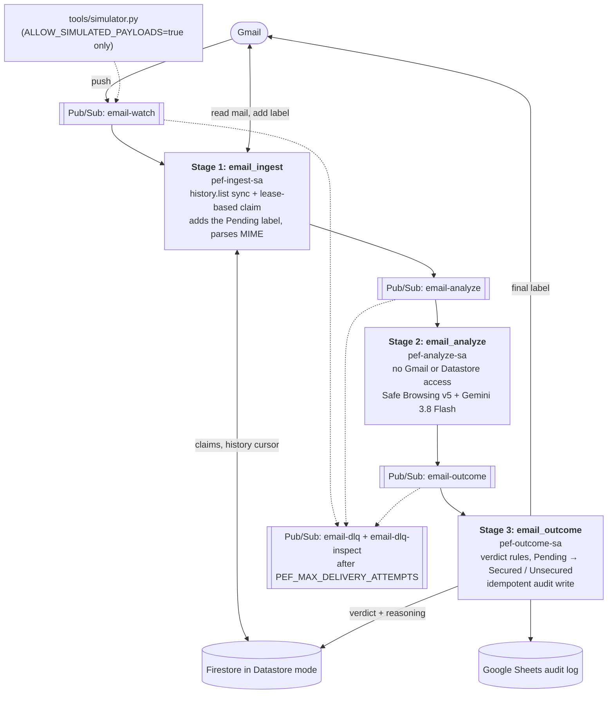
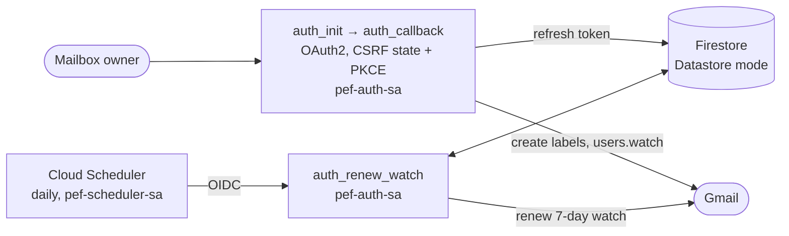

# Zero Infrastructure, Zero Phishing: Serverless Email Security with Gemini 3.8 Flash

[](https://github.com/googleapis/python-genai)
[](https://ai.google.dev/gemini-api/docs/models/gemini-3.8-flash)
[-0F9D58.svg)](https://docs.cloud.google.com/functions/docs/runtime-support)
[](https://developers.google.com/safe-browsing/reference)
[](https://github.com/lineargs/pef-gemini/actions/workflows/ci.yml)
[](LICENSE)

An end-to-end reference architecture and starter kit demonstrating how to build an **explainable, event-driven serverless email security pipeline** on **Gemini Enterprise Agent Platform** (formerly Vertex AI) using **Cloud Run Functions (2nd Gen)**, **Cloud Pub/Sub**, **Google Safe Browsing v5 / Web Risk**, and **Gemini 3.8 Flash (`gemini-3.8-flash`)**, which escalates the emails it is unsure about to **Gemini 4 Argon (`gemini-4-argon`)**, via the unified **Google Gen AI SDK (`google-genai >= 2.0.0`)**.

> **Academic & Engineering Lineage**: Evolved from the MSc Software Engineering dissertation (*"Cloud AI and Machine Learning Framework for Phishing Email Filtering"*, Goran Minov, University of West London), then rebuilt in 2026 around Cloud Run functions and Gemini 3.8 Flash.

---

## Table of Contents

- [The Core Narrative: From 2021 AutoML NL to 2026 Gemini 3.8 Flash](#the-core-narrative-from-2021-automl-nl-to-2026-gemini-38-flash)
  - [Offline Pipeline Smoke-Test Stub vs. Live Gemini Evaluation](#offline-pipeline-smoke-test-stub-vs-live-gemini-evaluation)
- [System Evolution & Pipe-and-Filter Architecture](#system-evolution--pipe-and-filter-architecture)
  - [Least-Privilege Service Account Isolation](#least-privilege-service-account-isolation)
  - [Side-by-Side Implementation Comparison (`v1` vs. `v2`)](#side-by-side-implementation-comparison-v1-vs-v2)
- [The Four Threat Archetypes Analysed (THREAT-01 to THREAT-04)](#the-four-threat-archetypes-analysed-threat-01-to-threat-04)
- [Scoring Architecture & Security Hardening](#scoring-architecture--security-hardening)
  - [1. The 6 Thesis Propositions](#1-the-6-thesis-propositions)
  - [2. Thesis Thresholds vs. Heuristic Single-Vector Cut-Offs](#2-thesis-thresholds-vs-heuristic-single-vector-cut-offs)
  - [3. Production AI & Cloud Security Guardrails](#3-production-ai--cloud-security-guardrails)
  - [4. Reliability: Retries, Dead Letters & Idempotency](#4-reliability-retries-dead-letters--idempotency)
- [Token Economics & the 2021 Framework](#token-economics--the-2021-framework)
  - [Full Architecture & Cost Comparison Matrix](#full-architecture--cost-comparison-matrix)
  - [How to Measure Cost per 1,000 Emails](#how-to-measure-cost-per-1000-emails)
  - [2021 Live Inbox Trial Distribution ($N = 298$)](#2021-live-inbox-trial-distribution-n--298)
  - [The 2021 Models](#the-2021-models)
- [Diagnostic & Simulation Tooling Walkthrough](#diagnostic--simulation-tooling-walkthrough)
  - [1. Pipeline Simulator (`tools/simulator.py`)](#1-pipeline-simulator-toolssimulatorpy)
  - [2. Architecture & Cost Benchmark (`tools/benchmark.py`)](#2-architecture--cost-benchmark-toolsbenchmarkpy)
  - [3. The 2021 Framework and a 2021-Style Replay (`tools/replay_2021_datasets.py`)](#3-the-2021-framework-and-a-2021-style-replay-toolsreplay_2021_datasetspy)
  - [4. Live Evaluation Harness (`tools/evaluate.py`)](#4-live-evaluation-harness-toolsevaluatepy)
  - [5. Automated Unit & Integration Suite (`tests/`)](#5-automated-unit--integration-suite-tests)
- [Local Quickstart & Production Cloud Deployment Guide](#local-quickstart--production-cloud-deployment-guide)
- [Licence](#licence)

---

## The Core Narrative: From 2021 AutoML NL to 2026 Gemini 3.8 Flash

Commercial email security gateways operate as opaque black boxes: an email is either silently quarantined or delivered to the inbox with zero explanation of *why* it was trusted. Building a transparent, self-hosted ML pipeline historically meant choosing between brittle regular expressions or training and maintaining your own models.

This repository traces the five-year architectural evolution of the **Phishing Email Framework (PEF)** across two generations:

1. **The 2021 AutoML Baseline (`PEF v1`)**: Built on 8 Cloud Functions (3 on Node.js 8, 5 on Node.js 10), with 5 Pub/Sub topics in sequence for each email, and backed by two custom-trained AutoML Natural Language models (12 hours of training in total):
   - `PEFURLs`: trained on **95,895 URLs** from the PhishStorm dataset (Marchal et al., 2014; 48,004 legitimate, 47,891 phishing); scored the sender domain and the links. Held-out precision **99.58%**, recall **95.09%** at a 0.95 threshold.
   - `PEFMessages`: trained on **52,162 emails** (31,519 legitimate, 20,643 phishing); scored the message body and text attachments. Held-out precision **99.41%**, recall **98.45%** at 0.95.
2. **What the 2021 Live Trial ($N = 298$ Emails, February to May 2021) Showed**:
   - **No Ground Truth**: The trial logged the framework's verdicts (168 of 298 flagged as phishing, 56%) but not which verdicts were correct, so it measured the models, not the system. There is no accuracy figure for v1 on real mail.
   - **Opaque Verdicts**: The pipeline emitted a single summed score in `[0, 6]` with no breakdown of *which* social-engineering tactics triggered the alert.
   - **Subtle Pipeline Bugs**: A JavaScript truthiness check (`if (total)`) in the final outcome function skipped every email scoring exactly `0`, so the cleanest emails never got a verdict and stayed in amber `[Pending]` forever. Ingest also read only the newest message per notification (`maxResults: 1`), so emails arriving together could be missed.
   - **Per-Prediction Cost**: Each email needed up to four AutoML predictions (domain, links, body, attachment).
3. **The 2026 Zero-Infrastructure Modernisation (`PEF v2`)**:
   - **Single-Pass Structured Reasoning**: Replaces both custom AutoML models and 4 intermediate Pub/Sub hops with **Gemini 3.8 Flash (`gemini-3.8-flash`)** configured with `response_schema=PhishingAnalysisResult` and `thinking_level="LOW"`. Emails Flash is unsure about get a second opinion from **Gemini 4 Argon** (see *Escalation to Gemini 4 Argon* below).
   - **Hybrid Reputation + Semantic Defence (Biased to Fail Closed)**: Combines Gemini's 4 component scores and 6 boolean proposition flags with a batched **Google Safe Browsing v5** lookup (`urls:search`; Web Risk for commercial use) that acts as a deterministic known-threat override. If the lookup is unavailable, the message is retried rather than scored blind, so an email is never labelled `Secured` without the check.
   - **Zero Idle Cost**: Compute scales to **\$0 at idle** on Cloud Run Functions (2nd Gen); the running cost is Gemini tokens, measured by `tools/evaluate.py`.

### Offline Pipeline Smoke-Test Stub vs. Live Gemini Evaluation

To let you verify the 3-stage pipeline, MIME parser, and threshold maths without GCP credentials or network access, [`tools/simulator.py`](tools/simulator.py) provides three explicit execution modes:

- **`--mode local` (Live Gemini 3.8 Flash Inference)**: Calls `gemini-3.8-flash` on **Gemini Enterprise Agent Platform** via `google-genai >= 2.0.0` using Application Default Credentials (`GOOGLE_GENAI_USE_ENTERPRISE=true`).
- **`--mode pubsub` (Live Cloud Pipeline Injection)**: Publishes test payloads directly to the deployed `email-watch` Cloud Pub/Sub topic to trigger the Cloud Run Functions end-to-end.
- **`--mode offline` (Deterministic CI Smoke-Test Stub)**: Uses a deterministic keyword stub (`_offline_heuristic_analysis`) to exercise routing and threshold logic in CI ([`.github/workflows/ci.yml`](.github/workflows/ci.yml)) and on machines without credentials. Offline outputs are explicitly prefixed with `[Offline Stub]` so deterministic smoke tests are never conflated with live LLM evaluation metrics.

Accuracy, token and cost figures for Gemini come only from saved live runs of [`tools/evaluate.py`](tools/evaluate.py) (see [Live Evaluation Harness](#4-live-evaluation-harness-toolsevaluatepy)). The offline stub is keyword-matched to the bundled sample emails, so its 8/8 result says nothing about model quality.

---

## System Evolution & Pipe-and-Filter Architecture

Each email passes through three Cloud Run functions joined by Pub/Sub topics:



Onboarding and watch renewal run separately, before and alongside the pipeline:



### Least-Privilege Service Account Isolation

A critical architectural security property of PEF v2—provisioned automatically in [`deploy.sh`](deploy.sh)—is **credential isolation across pipeline stages**:

| Service Account | Attached Functions | IAM Roles Granted | Blast-Radius Guarantee |
| :--- | :--- | :--- | :--- |
| `pef-auth-sa` | `auth_init`, `auth_callback`, `auth_renew_watch` | `roles/datastore.user` | Handles OAuth2 onboarding and daily `users.watch` renewal via Cloud Scheduler OIDC. |
| `pef-ingest-sa` | `email_ingest` | `roles/datastore.user`, `roles/pubsub.publisher` on `email-analyze` only | Reads Gmail message via `history.list`, applies `Pending`, and publishes normalised JSON. |
| **`pef-analyze-sa`** | **`email_analyze` (Stage 2)** | **`roles/aiplatform.user`, `roles/pubsub.publisher` on `email-outcome` only** | **Holds ZERO Datastore permissions and ZERO Gmail OAuth tokens.** Even if a hostile email triggers a prompt injection, Stage 2 cannot read, modify, or exfiltrate the user's mailbox. |
| `pef-outcome-sa` | `email_outcome` | `roles/datastore.user` | Swaps `Pending` for `Secured`/`Unsecured` and writes the audit log. |
| `pef-trigger-sa` | Eventarc triggers for the 3 pipeline functions | `roles/run.invoker` on each pipeline function only | The only identity allowed to invoke the event-driven functions. |
| `pef-scheduler-sa` | Cloud Scheduler job `pef-gmail-watch-renewal` | `roles/run.invoker` on `auth_renew_watch` only | Calls the daily watch renewal with an OIDC token; `auth_renew_watch` is not publicly invokable. |

### Side-by-Side Implementation Comparison (`v1` vs. `v2`)

```python
# ============================================================================
# 2021 THESIS BASELINE (PEF v1 — Node.js 8/10 + AutoML NL + 5 Pub/Sub hops), real code
# ============================================================================
# 1. email_domain: no domain at all for a bare address (no angle brackets):
#    const email = sEmail.match(new RegExp('<(.*)>'));
#    if (email) { return "https://" + email[1].split('@').pop(); }  // "a@b.com" -> undefined
#
# 2. email_watch: only the newest message, and no INBOX filter -> bursts were missed:
#    gmail.users.messages.list({ userId: email, maxResults: 1 })
#
# 3. email_outcome: a total of 0 is falsy in JavaScript -> no label, no sheet row:
#    if (total) { await getPhishingEmailOutcome(...); await updateReferenceSheet(...); }

# ============================================================================
# 2026 MODERNIZED PIPELINE (PEF v2 — Python 3.12 + google-genai >= 2.0.0)
# ============================================================================
# 1. Unicode-escaped JSON + per-request random boundary (functions/email_analyze/main.py)
def _escape_prompt_json(raw_obj: dict[str, Any]) -> str:
    # Escapes `<` and `>` so `</UNTRUSTED_EMAIL_JSON_...>` cannot be injected in email text
    return json.dumps(raw_obj, indent=2).replace("<", "\\u003c").replace(">", "\\u003e")

# 2. Gemini 3.8 Flash config: response_schema=PydanticClass, thinking_level=LOW, no temperature
def _build_generate_content_config(thinking_level: str = "LOW") -> Any:
    from google.genai import types

    level_enum = getattr(types.ThinkingLevel, thinking_level.upper(), thinking_level.upper())
    return types.GenerateContentConfig(
        system_instruction=SYSTEM_INSTRUCTION,
        response_mime_type="application/json",
        response_schema=PhishingAnalysisResult,
        thinking_config=types.ThinkingConfig(thinking_level=level_enum),
    )

# 3. Known-threat override + heuristic single-vector cut-off (functions/email_outcome/main.py)
#    (simplified: the real function reads the cut-offs from PEF_CONFIDENCE_CUTOFF / PEF_COMPONENT_CUTOFF)
def determine_verdict_label(
    total_score: float,
    maximum_score: int,
    gemini_is_phishing: bool = False,
    gemini_confidence: float = 0.0,
    domain_sb_malicious: bool = False,
    links_sb_malicious: bool = False,
    max_component_score: float = 0.0,
) -> str:
    if domain_sb_malicious or links_sb_malicious:
        return "Unsecured"
    threshold = THRESHOLDS_BY_MAX_SCORE.get(maximum_score, 1.90)
    if total_score >= threshold:
        return "Unsecured"
    if gemini_is_phishing and (gemini_confidence >= 0.85 or max_component_score >= 0.90):
        return "Unsecured"
    return "Secured"
```

---

## The Four Threat Archetypes Analysed (THREAT-01 to THREAT-04)

[`tools/sample_emails.json`](tools/sample_emails.json) includes 4 phishing archetypes (`msg-phish-001` to `msg-phish-004`) paired with 4 legitimate emails (`msg-legit-001` to `msg-legit-004`) across all four structural categories.

> The verdicts below are the **expected** labels in `sample_emails.json`, i.e. what each archetype is designed to test. Whether Gemini reproduces them is measured, not asserted: run `python tools/evaluate.py --mode local` and quote the saved summary. Eight hand-written emails are a demo set, not an accuracy benchmark.

### THREAT-01: Typosquatted OAuth Credential Harvesting (`msg-phish-001`)

- **Category**: `Links, but no attachment` ($k = 3$ AI checks + 2 Safe Browsing checks, Max Score = `5`, Thesis Threshold = `2.85`)
- **Incoming Payload**:
  - **From**: `Microsoft 365 Security <security-alert@m1crosoft-auth-verify.com>`
  - **Subject**: `"URGENT: Your corporate mailbox will be suspended in 2 hours"`
  - **Body URL**: `https://login.m1crosoft-auth-verify.com/oauth2/authorize?session=89f4a2c19b83e71d0049a8b7c6d5e4f3&redirect=inbox`
- **Active Propositions**: `urgency`, `authority`, `suspicious_long_urls`, `unsolicited_context`, `personal_or_financial_request` $\rightarrow$ expected **`[Unsecured]`**

### THREAT-02: Linkless Executive BEC & Urgent Wire Transfer (`msg-phish-002`)

- **Category**: `No attachment and no links` ($k = 2$ AI checks + 1 Safe Browsing check, Max Score = `3`, Thesis Threshold = `1.90`)
- **Incoming Payload**:
  - **From**: `Chief Executive Officer <ceo.office.urgent@gmail.com>`
  - **Subject**: `"Confidential: Urgent Wire Transfer & Payroll Tax Filing"`
  - **Body**: *"I am currently in a board meeting and cannot take calls. I need you to process an urgent confidential wire transfer of \$48,500 to our new vendor before 12:00 PM today, and reply directly to this email with the company corporate card details and routing number."*
- **Why `v1` Failed & What `v2` Is Designed to Catch**:
  - **In 2021 (`PEF v1`)**: With no URLs and a clean sender domain (`gmail.com`), only the body and domain models would have scored it, and the result would have been one number between 0 and 3 with no reason attached.
  - **In 2026 (`PEF v2`)**: the system instruction asks `gemini-3.8-flash` to score the mismatch between the claimed `Chief Executive Officer` identity and the public `@gmail.com` address, and to flag `urgency`, `authority`, `unsolicited_context`, and `personal_or_financial_request` $\rightarrow$ expected **`[Unsecured]`**.

### THREAT-03: Malicious Text Attachment Reward Trap (`msg-phish-003`)

- **Category**: `Attachment, but no links` ($k = 3$ AI checks + 1 Safe Browsing check, Max Score = `4`, Thesis Threshold = `2.85`)
- **Incoming Payload**:
  - **From**: `HR Rewards Department <rewards@global-bonus-payouts.net>`
  - **Attachment**: `Claim_Instructions_2026.txt` (*"To release your \$5,000 loyalty bonus within 24 hours, reply with: ... Online Banking Username & One-Time Passcode, Bank Account & Sort Code"*)
- **Why it Matters**: Attackers move credential harvesting instructions into attachments to evade body-only filters. [`parse_gmail_mime_message`](functions/email_ingest/main.py) recursively walks nested MIME parts and prioritises text-inspectable attachments (`.txt`, `.csv`, `.html`, `.md`, `.json`, `.xml`, `.eml`) over preceding inline signature images $\rightarrow$ expected **`[Unsecured]`**.

### THREAT-04: Multi-Vector Courier Customs Lure (`msg-phish-004`)

- **Category**: `Attachment and links` ($k = 4$ AI checks + 2 Safe Browsing checks, Max Score = `6`, Thesis Threshold = `3.80`)
- **Incoming Payload**:
  - **From**: `DHL Express Customs <customs-clearance@dhl-parcel-track-uk.info>`
  - **Body URL**: `https://pay.dhl-parcel-track-uk.info/customs/checkout?id=GB9948120`
  - **Attachment**: `Shipping_Manifest_GB9948120.txt`
- **Pipeline Behaviour**: Evaluates all 4 AI dimensions (`domain`, `links`, `body`, `attachment`) plus batched Safe Browsing lookup across the sender domain and checkout URL $\rightarrow$ expected **`[Unsecured]`**.

---

## Scoring Architecture & Security Hardening

### 1. The 6 Thesis Propositions

Every email is evaluated against the strict Pydantic schema [`PhishingAnalysisResult`](functions/email_analyze/main.py), which returns continuous component scores (`[0.0, 1.0]`) and 6 boolean phishing propositions:

1. **`urgency`**: Artificial deadlines, account suspension threats, or immediate action demands.
2. **`authority`**: Impersonation of IT administrators, executives (CEO/CFO), banks, couriers, or government bodies.
3. **`suspicious_long_urls`**: Typosquatted domains (`m1crosoft-auth-verify.com`), deep redirect chains, or obfuscated hosts.
4. **`unsolicited_context`**: Unrequested password resets, unexpected invoices, or customs fee lures.
5. **`incredible_deals`**: Too-good-to-be-true grants, lottery prizes, or loyalty payouts.
6. **`personal_or_financial_request`**: Solicitation of credentials, MFA codes, wire transfers, or banking details.

### 2. Thesis Thresholds vs. Heuristic Single-Vector Cut-Offs

In the 2021 dissertation, the composite threshold was defined as $k \times 0.95$, where $k \in \{2, 3, 4\}$ is the number of active ML checks. While preserved in [`compute_composite_score`](functions/email_analyze/main.py) for direct comparability with the 2021 study, summing $k \times 0.95$ across uncalibrated LLM component scores has a subtle vulnerability: if a phishing email comes from a legitimate domain (`domain_phishing_score = 0.20`) or uses benign cover text with a malicious attachment (`attachment_phishing_score = 0.96`), requiring *all* $k$ components to average $\ge 0.95$ can dilute a single high-severity threat vector.

To prevent benign components from masking a single malicious vector, [`determine_verdict_label`](functions/email_outcome/main.py) combines three layers (biased to fail closed towards `Unsecured`):

| Email Category | Active AI Checks ($k$) | Safe Browsing Checks | Max Score | 2021 Thesis Threshold ($k \times 0.95$) | PEF v2 Verdict Rule (`Unsecured` if ANY holds) |
| :--- | :---: | :---: | :---: | :---: | :--- |
| **No attachment and no links** | 2 (Domain + Body) | 1 (Domain) | 3 | **1.90** | Safe Browsing Hit **OR** `total >= 1.90` **OR** (`is_phishing` & `confidence >= 0.85` / `max_comp >= 0.90`) |
| **Links, but no attachment** | 3 (Domain + Links + Body) | 2 (Domain + Links) | 5 | **2.85** | Safe Browsing Hit **OR** `total >= 2.85` **OR** (`is_phishing` & `confidence >= 0.85` / `max_comp >= 0.90`) |
| **Attachment, but no links** | 3 (Attachment + Domain + Body) | 1 (Domain) | 4 | **2.85** | Safe Browsing Hit **OR** `total >= 2.85` **OR** (`is_phishing` & `confidence >= 0.85` / `max_comp >= 0.90`) |
| **Attachment and links** | 4 (Attachment + Domain + Links + Body) | 2 (Domain + Links) | 6 | **3.80** | Safe Browsing Hit **OR** `total >= 3.80` **OR** (`is_phishing` & `confidence >= 0.85` / `max_comp >= 0.90`) |

> **The 0.85 / 0.90 cut-offs are hand-picked starting values, not calibrated ones.** Gemini's self-reported scores are not probabilities, so treat them as ordinal signals. Choose cut-offs on a labelled set with `python tools/evaluate.py --mode local --sweep`, then set `PEF_CONFIDENCE_CUTOFF` / `PEF_COMPONENT_CUTOFF`; ideally tune on one set and report results on another.

### 3. Production AI & Cloud Security Guardrails

- **Un-escapable Prompt-Injection Boundary (OWASP LLM01)**: [`_escape_prompt_json`](functions/email_analyze/main.py) unicode-escapes all `<` (`\u003c`) and `>` (`\u003e`) characters before wrapping the JSON in a per-request cryptographic random tag (`<UNTRUSTED_EMAIL_JSON_<16-hex-chars>>`). An attacker cannot inject a closing delimiter tag inside an email body or attachment. For enterprise deployments, combine this with **Google Cloud Model Armor** on Agent Platform to screen prompts and URLs at the API gateway layer.
- **Known-Threat Reputation Check (Retry on Outage)**: [`check_reputation`](functions/email_analyze/main.py) checks the sender domain and extracted URLs with the Safe Browsing v5 `urls:search` method (up to 50 per request; a bare sender domain is sent as `http://domain/`) and runs *before* Gemini. A match can be reported for a host-suffix or path-prefix expression of a URL (for example `evil.example/` for `https://login.evil.example/x`), so matches are mapped back to every URL they cover, and a match that can't be mapped counts against all URLs in the batch rather than being dropped. v5 answers in protocol buffers, which the function decodes itself (no extra dependency). The matched threat types (`SOCIAL_ENGINEERING`, `MALWARE`, …) are carried to the audit record and the sheet. With `SAFE_BROWSING_FAIL_CLOSED=true` (default), a timeout or 5xx raises `SafeBrowsingUnavailableError`: Pub/Sub redelivers with backoff, and after `PEF_MAX_DELIVERY_ATTEMPTS` the message goes to the dead-letter topic. The email stays `Pending` until it can be checked, so an outage neither marks mail `Secured` unchecked nor permanently marks it `Unsecured`. With `SAFE_BROWSING_FAIL_CLOSED=false` the pipeline continues on Gemini alone. Every outcome records `reputationStatus` (`ok`, `no_urls`, `disabled` when no API key is set, `error` for a permanent 4xx such as a bad key, or `unavailable`), and `email_outcome` logs a warning whenever an email was scored without a reputation check. *(Note: the Google Safe Browsing API, v5 included, is for non-commercial use only; commercial SMB deployments should point the lookup at the commercial **Google Cloud Web Risk API**. v4 is deprecated, which is why this project moved to v5.)* To check that your key and the lookup work end to end, run `python tools/check_safe_browsing.py`: it calls the same `check_reputation` code against Google's always-listed test pages and a clean URL, reads the key from the environment, `.env` or Secret Manager, never prints it, and exits non-zero on any failure.
- **Incremental `history.list` Sync & Daily Watch Renewal**: [`email_ingest`](functions/email_ingest/main.py) reads `users.history.list(historyTypes=["messageAdded"], labelId="INBOX")` from the stored `lastHistoryId`, following every `nextPageToken`. It falls back to scanning the latest INBOX messages only when there is no cursor yet or it has expired (404). [`auth_renew_watch`](functions/auth_setup/main.py) is triggered daily by Cloud Scheduler so Gmail's 7-day `users.watch` subscription never silently expires. The renewal only seeds the cursor on first setup and never overwrites it, so mail that arrived while ingest was failing is not skipped.
- **OAuth2 CSRF Nonce, PKCE & Fail-Closed Email Allowlist**: [`auth_init`](functions/auth_setup/main.py) stores a single-use cryptographic `state` nonce and PKCE `code_verifier` in Datastore; [`auth_callback`](functions/auth_setup/main.py) atomically consumes the nonce and rejects any email address not listed in `ALLOWED_EMAILS` (failing closed when `ALLOWED_EMAILS` is unset).
- **Escalation to Gemini 4 Argon**: every email is analysed by `GEMINI_MODEL` (`gemini-3.8-flash`). If its phishing probability (`overall_confidence`) falls between **0.20 and 0.88**, i.e. Flash is unsure, [`analyze_with_gemini_detailed`](functions/email_analyze/main.py) sends the same escaped prompt to `GEMINI_ESCALATION_MODEL` (`gemini-4-argon` in `.env.example`) and uses that result. Confident verdicts and policy blocks are never escalated. If the escalation call fails with a timeout, rate limit or server error, it is retried once, as long as a second attempt still fits inside the function timeout; if it fails again, or fails for another reason (model unavailable in your location), the Flash result is kept and the failure is recorded with the call and in the audit log (`geminiEscalationError`), so a borderline email is never stuck waiting for the bigger model. An escalated email pays for both calls; `tools/evaluate.py` reports the escalation rate and the blended cost. Leave `GEMINI_ESCALATION_MODEL` empty to run on Flash alone. Every Gemini request has a timeout (`GEMINI_TIMEOUT_SECONDS`, default 55), so a first pass plus an escalation fit inside the 120-second function timeout and a stuck request can't hang the stage. The band is a starting heuristic: tune it on a labelled set.
- **Token Metering**: every Gemini call's `usage_metadata` (prompt, output and thinking tokens, plus model) travels with the outcome event and is stored on the `EmailAuditLog` entity, so production cost per email can be queried rather than estimated.
- **PII-Free Logging & Spreadsheet Formula Sanitisation**: `SYSTEM_INSTRUCTION` forbids quoting raw PII or credentials in `reasoning`, `email_outcome` omits `reasoning` from Cloud Logging unless `LOG_FULL_REASONING=true`, and [`_append_to_google_sheet`](functions/email_outcome/main.py) writes with `valueInputOption="RAW"` plus leading-apostrophe escaping (`_sanitize_sheet_cell`).

### 4. Reliability: Retries, Dead Letters & Idempotency

All three Pub/Sub-triggered functions deploy with `--retry`. [`deploy.sh`](deploy.sh) then attaches each trigger's Eventarc-managed subscription to the `email-dlq` dead-letter topic with exponential backoff (`PEF_MIN_RETRY_DELAY`=10s to `PEF_MAX_RETRY_DELAY`=600s, `PEF_MAX_DELIVERY_ATTEMPTS`=10). It also creates the `email-dlq-inspect` subscription so dead-lettered messages are kept for 7 days instead of being dropped. Each stage is safe to run twice:

| Stage | Retry hazard | How it is handled |
| :--- | :--- | :--- |
| `email_ingest` | Publish fails after the message was marked processed, so the retry skips it and the email sits in `Pending` forever | Each message is claimed with a lease (`PEF_CLAIM_LEASE_SECONDS`, default 300, kept above `FUNCTION_TIMEOUT`, default 120s). It is marked `published` only after the publish succeeds, and the lease is cleared on failure. |
| `email_ingest` | A worker crashes while holding a lease, and the redelivered notification is acknowledged without the message | If any message is leased elsewhere, the invocation raises `LeaseHeldError` after handling the rest. Pub/Sub then backs off and retries past the lease expiry, and the history cursor is not advanced past that message. |
| `email_ingest` | One message that always fails blocks every later message in the mailbox | Attempts are counted per message. After `PEF_MAX_MESSAGE_ATTEMPTS` (default 5) the message is parked as `failed` and left labelled `Pending` ("not scanned"), with an error log, and the rest of the mailbox continues. Published payloads are bounded (body and attachment text to 32,000 characters, at most 500 URLs, extracted from the full body) so they stay far below Pub/Sub's 10 MB limit. Messages deleted before they could be read (404) are marked `skipped`. |
| `email_ingest` | Bursts or out-of-order notifications skip mail | `history.list` is paginated. The cursor advances only after the whole batch succeeds and never moves backwards, and the daily watch renewal never overwrites it. |
| `email_analyze` | Retrying after Gemini succeeded pays for tokens twice | The reputation check runs first, so an outage fails fast before any Gemini call. Lookups are split into batches of 50 URLs (the `urls:search` maximum); ingest caps an email at 500 URLs, so at most 10 requests. Permanent 4xx errors (bad key, API disabled) are recorded as `reputationStatus=error` instead of being retried. |
| `email_analyze` | The model refuses the content (SAFETY, PROHIBITED_CONTENT and similar), and every retry gets the same refusal | Fails closed in one step: the email is scored `Unsecured` with reasoning "Not analysed: the model declined this content" and `geminiBlocked` set in the audit log. Other empty responses (for example `MAX_TOKENS`) raise and are retried. |
| `email_outcome` | Duplicate Sheets rows, or a duplicate analysis that disagrees leaving both `Secured` and `Unsecured` labels | The audit record is first-writer-wins inside a transaction, so the label, the audit entity and the Sheets row always use the first recorded verdict. The label swap removes `Pending` and the opposite verdict label. The Sheets append is claimed in a transaction (`sheetAppended`, `sheetClaimUntil`), and a 404 on a deleted message is ignored. |

Nobody has to watch for failures: `deploy.sh` creates three Cloud Monitoring alerts with [`tools/alerts.py`](tools/alerts.py), emailed to `ALERT_EMAIL` (default: the first address in `ALLOWED_EMAILS`; `none` turns them off):

| Alert | Fires when | What to do (also in the email) |
| :--- | :--- | :--- |
| **PEF: email in the dead-letter queue** | `email-dlq-inspect` holds any message (metric alert on `num_undelivered_messages`) | Read and clear it with `gcloud pubsub subscriptions pull email-dlq-inspect --limit=10 --auto-ack`, then check the logs. Closes once the subscription is empty. |
| **PEF: Gmail sign-in needs renewing** | Google rejects the stored refresh token (`invalid_grant`: expired, revoked, password changed; logged as `PEF_AUTH_EXPIRED`) or the daily watch renewal fails (`PEF_WATCH_RENEWAL_FAILED`) | Open the onboarding URL (linked in the email) and sign in again. |
| **PEF: email could not be scanned** | An email is parked after `PEF_MAX_MESSAGE_ATTEMPTS` (`PEF_MESSAGE_FAILED`); these never reach the dead-letter queue | The email is still labelled `Pending`; the log line names it. |

The two log alerts send at most one email an hour. Alerting policies are free until at least 1 September 2027; after that Google charges $0.35 a month per metric condition (one here).

---

## Token Economics & the 2021 Framework

### Full Architecture & Token Cost Comparison Matrix

| Dimension | 2021 MSc Thesis (`PEF v1` — AutoML NL) | 2026 Modernized (`PEF v2` — Gemini on Agent Platform) | Architectural & Economic Notes |
| :--- | :--- | :--- | :--- |
| **AI / ML Engine** | 2 Custom AutoML NL Models (`PEFURLs` + `PEFMessages`) | **Gemini 3.8 Flash** (`thinking_level="LOW"`) + **Gemini 4 Argon** for borderline emails | Eliminates dual-model training & hosting |
| **Dataset Curation & Training** | 148,057 labelled rows (95,895 PhishStorm URLs + 52,162 emails) + **12 hours** training | **Zero-shot** Structured Outputs (**0 hours**) | Immediate deployment without training lag |
| **Cloud Run Functions** | 8 Cloud Functions (Node.js 8 and 10) | **3 Pipeline Functions** (`ingest`, `analyze`, `outcome`) + **Auth/Renewal** (`auth_setup`) | Least-privilege service account per stage |
| **Pub/Sub Hops per Email** | 5 sequential topics | **2 decoupled hops** (`ingest` $\rightarrow$ `analyze` $\rightarrow$ `outcome`) + `--retry` | Lower tail latency & automatic retry recovery |
| **Accuracy on Real Mail** | Not measured (verdicts logged, ground truth not recorded) | **Measured** on a labelled set with `tools/evaluate.py` | System-level evaluation instead of model-only scores |
| **Attachment Inspection** | One attachment per email, decoded as text and scored by `PEFMessages` | **Text attachments** (`.txt`, `.csv`, `.html`, `.md`, `.json`, `.xml`, `.eml`) + MIME metadata | Prioritises text attachments over inline images |
| **Explainability** | Single opaque float in `[0, 6]` | **6 Proposition flags + PII-free reasoning summary** | Stored in Datastore (`EmailAuditLog`) & Sheets |
| **Pricing Model** | Per AutoML prediction, up to 4 per email, plus training hours | Per Gemini token; **\$0 compute at idle** | No models to train or host |
| **Inference Cost / 1,000 Emails** | Not recorded | **Measured per run** by `tools/evaluate.py` from real token usage (see below) | |

### How to Measure Cost per 1,000 Emails

Cost depends on email length and on how many thinking tokens the model spends, so this README does not quote a fixed figure. `tools/evaluate.py` reads `usage_metadata` from every call and reports the measured average:

$$\text{cost per 1,000 emails} = \frac{1{,}000}{10^6} \times \left(\text{prompt tokens} \times p_{in} + (\text{output} + \text{thinking tokens}) \times p_{out}\right)$$

| Model | $p_{in}$ (USD / 1M) | $p_{out}$ incl. thinking (USD / 1M) | Notes |
| :--- | ---: | ---: | :--- |
| `gemini-3.8-flash` | 0.75 | 3.75 | Promotional until 31 Dec 2026; **1.50 / 7.50 from 1 Jan 2027** |
| `gemini-4-argon` | 2.00 | 10.00 | Introductory until 30 Nov 2026; **4.00 / 20.00 from 1 Dec 2026**. Used only for escalated emails |

*Illustration only, not a measurement:* an email that uses 1,000 prompt tokens (the system instruction alone is roughly 650), 200 output tokens and 300 thinking tokens on `gemini-3.8-flash` costs about **\$2.63 per 1,000 emails** at promotional prices, or **\$5.25** from January 2027. Long HTML emails cost more. An escalated email pays for both calls: with the same token counts, the Argon call adds about **\$7.00 per 1,000 escalated emails** at introductory prices (\$14.00 from December 2026), so at a 10% escalation rate the blend is about **\$3.33 per 1,000 emails**. The harness reports the measured escalation rate and blended cost. Prices from the [Gemini API pricing page](https://ai.google.dev/gemini-api/docs/pricing), checked October 2026; re-price a saved run with `--replay ... --prices '{...}'`.

### 2021 Live Inbox Trial Distribution ($N = 298$)

During the live trial (February to May 2021), the framework classified 298 real emails across the four structural categories:

| Email Category | Volume ($N$) | Share (%) | Flagged as phishing | Not flagged | Threshold |
| :--- | :---: | :---: | :---: | :---: | :---: |
| **No attachments and no URLs** | 67 | 22.5% | 33 | 34 | 1.90 / 3 |
| **URLs, but no attachments** | 223 | 74.8% | 135 | 88 | 2.85 / 5 |
| **Attachments, but no URLs** | 3 | 1.0% | 0 | 3 | 2.85 / 4 |
| **Attachments and URLs** | 5 | 1.7% | 0 | 5 | 3.80 / 6 |
| **Total** | **298** | | **168 (56%)** | **130** | |

These are the framework's **verdicts, not ground truth**: which verdicts were correct was not recorded, so the trial has no accuracy figure. 97.3% of the emails had either no links or links but no attachment.

### The 2021 Models

Confirmed facts about the 2021 framework are in [`datasets/thesis_2021_slice.json`](datasets/thesis_2021_slice.json):

| Model | Used for | Training data | Held-out precision / recall at 0.95 |
| :--- | :--- | :--- | :---: |
| `PEFURLs` | Sender domain and body URLs | 95,895 URLs from PhishStorm (Marchal et al., 2014): 48,004 legitimate, 47,891 phishing | 99.58% / 95.09% |
| `PEFMessages` | Message body and text attachments | 52,162 emails (31,519 legitimate, 20,643 phishing) | 99.41% / 98.45% |

Both are AutoML Natural Language single-label classifiers (AutoML API v1), trained for 12 hours in total. Their scores are on held-out training data; the live trial above has verdicts but no ground truth.

---

## Diagnostic & Simulation Tooling Walkthrough

### 1. Pipeline Simulator (`tools/simulator.py`)

Run all 8 sample emails (or any individual email ID) through the 3-stage pipeline:

```bash
# Offline deterministic smoke test (CI, no credentials or network)
python3 tools/simulator.py --mode offline --email-id msg-phish-002

# Live Gemini 3.8 Flash evaluation on Gemini Enterprise Agent Platform
export GOOGLE_CLOUD_PROJECT="your-gcp-project-id"
export GOOGLE_CLOUD_LOCATION="global"
export GOOGLE_GENAI_USE_ENTERPRISE="true"
python3 tools/simulator.py --mode local --email-id msg-phish-002
```

```text
PEF v2 Pipeline Simulator — Mode: OFFLINE HEURISTIC STUB (CI Smoke Test) (1 email(s))

━━━━━━━━━━━━━━━━━━━━━━━━━━━━━━━━━━━━━━━━━━━━━━━━━━━━━━━━━━━━━━━━━━━━━━━━━━━━━━
Email ID: msg-phish-002  |  Initial Gmail Label: [Pending]
From:     Chief Executive Officer <ceo.office.urgent@gmail.com> (https://gmail.com)
Subject:  Confidential: Urgent Wire Transfer & Payroll Tax Filing
Category: No attachment and no links (Links=False, Attachment=False)
Scores:   Domain=0.98 | Links=0.00 | Body=0.99 | Attachment=0.00
Propositions Triggered: urgency, authority, unsolicited_context, personal_or_financial_request
Total Score: 1.97 / 3 (Thesis Threshold: 1.90)  |  Latency: 0 ms
Final Gmail Label: [Unsecured]  (Expected: Unsecured)
Stub Reasoning:    [Offline Stub] Flagged phishing indicators: urgency, authority, unsolicited_context, personal_or_financial_request.

━━━━━━━━━━━━━━━━━━━━━━━━━━━━━━━━━━━━━━━━━━━━━━━━━━━━━━━━━━━━━━━━━━━━━━━━━━━━━━
Summary (OFFLINE): 1/1 verdicts matched expected outcome.
```

### 2. Architecture & Cost Benchmark (`tools/benchmark.py`)

Prints the side-by-side architecture and token-economics table, the 2021 live trial distribution, and evaluates the 8-email sample corpus:

```bash
# Run against live Gemini 3.8 Flash:
python3 tools/benchmark.py --mode local

# Or run offline pipeline smoke-test verification:
python3 tools/benchmark.py --mode offline
```

### 3. The 2021 Framework and a 2021-Style Replay (`tools/replay_2021_datasets.py`)

Prints the confirmed facts about the 2021 framework (models, pipeline, live-trial verdicts), then runs four **synthetic** emails written in the style of 2021 lures through the PEF v2 pipeline. The 2021 trial emails were a private inbox and are not in this repository.

```bash
python3 tools/replay_2021_datasets.py --mode offline
# Or with live Gemini 3.8 Flash:
python3 tools/replay_2021_datasets.py --mode local
```

### 4. Live Evaluation Harness (`tools/evaluate.py`)

The source of every accuracy, token and cost number you quote. It runs a labelled set through the real pipeline functions and saves `evals/results/<run_id>.jsonl` (one line per email: verdict, scores, propositions, per-call tokens, cost, latency) plus a `<run_id>.summary.md` with:

- the confusion matrix with **Wilson 95% confidence intervals** for precision, recall and false-positive rate (and a warning when N < 100);
- measured **prompt / output / thinking tokens, cost per 1,000 emails**, escalation rate and p50/p95 latency;
- with `--sweep`, precision/recall/F1 for the thesis threshold alone and for a grid of heuristic cut-offs.

```bash
# Live run on Agent Platform (ADC + GOOGLE_CLOUD_PROJECT + GOOGLE_GENAI_USE_ENTERPRISE=true)
python3 tools/evaluate.py --mode local --sweep

# Your own labelled set: JSON list or JSONL; each item needs expectedVerdict
# ("Secured"/"Unsecured") or label ("phishing"/"legitimate")
python3 tools/evaluate.py --mode local --dataset path/to/labelled.jsonl --sweep --with-reputation

# Recompute (or re-price) a saved run without calling Gemini
python3 tools/evaluate.py --replay evals/results/<run_id>.jsonl --sweep \
  --prices '{"gemini-3.8-flash": {"input": 1.50, "output": 7.50}}'
```

Add `--workers 8` to analyse emails in parallel; a few hundred emails then take minutes rather than an hour. Ctrl-C stops a run and still writes the summary for the emails that finished, and `--replay` rebuilds a summary from any saved `.jsonl`.

#### A Public Benchmark Set, No Labelling Required

[`tools/build_eval_set.py`](tools/build_eval_set.py) builds a labelled set from two files of the **Phishing Email Curated Datasets** (Champa, Rabbi and Zibran, 2024; [zenodo.org/records/8339691](https://zenodo.org/records/8339691), CC BY 4.0): `Nazario.csv` (real phishing collected by Jose Nazario, 2015–2022) and `SpamAssasin.csv` (the SpamAssassin public corpus, of which only the legitimate emails are used, 2002). Download both into `evals/data/` (git-ignored), then:

```bash
python3 tools/build_eval_set.py                  # 200 phishing + 200 legitimate, seed 2026
python3 tools/evaluate.py --mode local --dataset evals/data/eval_set.json --sweep --workers 8
```

It removes mbox artefacts, near-empty bodies and duplicates, drops the recipient address, and splits each class evenly between emails with and without a URL in the body, so a model can't score well just by noticing links. The same seed gives the same sample, and `eval_set.manifest.json` records the source files' SHA-256 and the counts. At Gemini 3.8 Flash prices, 400 emails cost roughly \$1 before escalations.

State these caveats with any result: the emails are old (phishing from 2015–2022, legitimate mail from 2002), both corpora are public and may be in a model's training data, the curated CSVs carry no attachments (so only the two "no attachment" categories are covered), and many Nazario bodies lost their link addresses during curation ("click HERE" with no URL), so they count as emails without links. Call the result accuracy on public benchmark data, not on your inbox.

For numbers about your own mail, use a consented, labelled export of it. `evals/results/` is git-ignored because runs on a real inbox can contain private content (message IDs, model reasoning). To publish a run so others can audit it, add it deliberately: `git add -f evals/results/<run_id>.*`.

### 5. Automated Unit & Integration Suite (`tests/`)

[`tests/test_pipeline.py`](tests/test_pipeline.py) covers parsing and scoring: RFC-5322 domain extraction, HTML URL unescaping, nested MIME attachment prioritisation, Safe Browsing v5 request and response parsing, the Gemini config (`response_schema`, `thinking_level="LOW"`, no `temperature`), escaped prompt delimiters, escalation to a second model (including when that call fails), OAuth2 CSRF/allowlist guardrails and formula-injection sanitisation.

[`tests/test_reliability.py`](tests/test_reliability.py) covers retry safety using an in-memory Datastore fake, built on the real `google.cloud.datastore` types when they are installed (and on minimal stand-ins otherwise, so the suite also runs on a bare Python):

- a failed publish is redelivered rather than stranded in `Pending`;
- leases block concurrent duplicates;
- the history cursor is never moved backwards or overwritten by watch renewal;
- a reputation outage raises before any Gemini tokens are spent;
- Safe Browsing lookups are batched at 50, matches on host or path expressions map back to the right URLs, and threat types reach the sheet's Safe Browsing column;
- token usage is recorded per call;
- blocked responses raise;
- Sheets rows are not duplicated on redelivery.

[`tests/test_teardown.py`](tests/test_teardown.py) checks that teardown revokes the stored refresh token before deleting records, keeps the verdict history unless asked, and changes nothing in a dry run. [`tests/test_build_eval_set.py`](tests/test_build_eval_set.py) checks that the benchmark set is balanced, cleaned and reproducible from its seed. [`tests/test_alerts.py`](tests/test_alerts.py) checks the alert policies, that a re-run updates rather than duplicates them, and that teardown deletes only what carries the `app=pef-gemini` label; `tests/test_reliability.py` also checks that the functions log the markers the alerts match on.

CI installs the real dependencies, so in CI the tests exercise the actual `google-genai`, Pydantic and Datastore code paths. A green run on a bare Python only proves the logic, not the SDK integration.

```bash
python3 -m pytest -v
```

---

## Local Quickstart & Production Cloud Deployment Guide

### 1. Local Environment Setup

```bash
git clone https://github.com/lineargs/pef-gemini.git
cd pef-gemini

python3 -m venv .venv
.venv/bin/pip install -r requirements.txt
```

### 2. Configure Google Cloud & Gemini 3.8 Flash (`--mode local`)

```bash
export GOOGLE_CLOUD_PROJECT="your-gcp-project-id"
export GOOGLE_CLOUD_LOCATION="global"
export GOOGLE_GENAI_USE_ENTERPRISE="true"

gcloud auth application-default login
.venv/bin/python tools/simulator.py --mode local
```

### 3. Before You Deploy: Run `setup.sh`

```bash
gcloud auth login
./setup.sh
```

[`setup.sh`](setup.sh) is an interactive first-time setup that writes `.env` for you (it creates it from `.env.example` if needed, and offers current values as defaults when re-run). It:

1. checks the project exists and has billing, and sets the region and the OAuth redirect URI;
2. asks for the mailbox address(es) to protect (`ALLOWED_EMAILS`);
3. prints the exact Cloud Console steps and values for the **OAuth client**, then asks you to paste its ID and secret (hidden). Google has no public API for creating this kind of client or its consent screen, so this is the one step no script can do for you;
4. asks whether to escalate borderline emails to **Gemini 4 Argon**;
5. asks whether to turn on the **Safe Browsing** check; if yes, enables the API, creates (or reuses) an API key restricted to Safe Browsing, and tests it against Google's test phishing page with the v5 `urls:search` method;
6. asks whether to log verdicts to an **audit Google Sheet**, prints the header row to paste, and takes the sheet's URL or ID.

With `USE_SECRET_MANAGER=true` in `.env`, the client secret and the Safe Browsing key go to Secret Manager instead of `.env`. Every API call is billed to the project you name, so a different `billing/quota_project` in your gcloud configuration doesn't get in the way. Nothing is deployed until you run `./deploy.sh`.

#### Doing it by hand

PEF reads and labels Gmail with your consent, through an OAuth client. In the [Cloud Console](https://console.cloud.google.com/auth/overview), in the project you will deploy to, under **Google Auth Platform**:

1. **Branding**: set an app name and a support email.
2. **Audience**: choose **External** (or **Internal** if the mailbox is in your Google Workspace organisation). For an External app in **Testing** status, add each mailbox you will protect as a **test user**.
3. **Data Access**: add the scopes `gmail.modify`, `spreadsheets`, `openid`, `userinfo.email` and `userinfo.profile`. `gmail.modify` is a restricted scope: test users can grant it without Google's verification.
4. **Clients** → **Create client**, type **Web application**, with this **authorised redirect URI** (it does not need to exist yet):

   ```text
   https://<GCP_REGION>-<GOOGLE_CLOUD_PROJECT>.cloudfunctions.net/auth_callback
   ```

   For example `https://us-central1-my-project.cloudfunctions.net/auth_callback`. `deploy.sh` derives the same URL and prints it at the end so you can compare.
5. Copy the client ID and secret into `.env` as `GOOGLE_CLIENT_ID` and `GOOGLE_CLIENT_SECRET`, and set `ALLOWED_EMAILS` to the mailbox address(es).

`deploy.sh` checks these values before it changes anything and stops with a list of what is missing.

Optional: a Safe Browsing API key (`SAFE_BROWSING_API_KEY`; the API is for non-commercial use, use Web Risk for commercial use) and an audit sheet (`GOOGLE_SHEET_ID`; owned by or shared with the onboarded mailbox, with a tab named `Sheet1`). Rows are appended to columns A to I; add this header row: `Message ID`, `Category`, `Score`, `Verdict`, `Model`, `Phishing probability`, `Signals`, `Reasoning`, `Safe Browsing`. `Score` is the thesis total (out of the category's maximum); `Model` shows which model decided, e.g. `gemini-3.8-flash → gemini-4-argon` when an email was escalated; `Phishing probability` is that model's `overall_confidence` (first passes between 0.20 and 0.88 are escalated); `Safe Browsing` shows the reputation check, e.g. `No match`, `Match: SOCIAL_ENGINEERING (links)`, `Off (no API key)` or `Not checked (lookup failed)`. If you format the header as a Sheets table, keep the table to the header row: rows are appended after a table's last row, so a table that spans 1,000 empty rows pushes new data to row 1,001. Leave either empty to go without it.

### 4. Production Deployment to Cloud Run Functions (Gen 2)

[`deploy.sh`](deploy.sh) is idempotent (safe to re-run). It:

- enables the required APIs and creates the Firestore database in Datastore mode (`FIRESTORE_LOCATION`, default `GCP_REGION`);
- creates the six least-privilege service accounts listed above, with topic-level Pub/Sub grants;
- provisions the topics (`email-watch`, `email-analyze`, `email-outcome`, `email-dlq`) and the `email-dlq-inspect` subscription;
- grants `gmail-api-push@system.gserviceaccount.com` publish rights on `email-watch`;
- deploys all Cloud Run functions, with `--retry` and dead-letter wiring on the event-driven ones;
- attaches resource labels (`RESOURCE_LABELS`, default `app=pef-gemini,managed-by=deploy-sh`) to the Cloud Run functions, Pub/Sub topics and subscriptions, for cost attribution in Cloud Billing and for `destroy.sh`;
- creates or updates the daily Cloud Scheduler job `pef-gmail-watch-renewal`;
- creates or updates the three Cloud Monitoring alerts described under [Reliability](#4-reliability-retries-dead-letters--idempotency), and an email notification channel for `ALERT_EMAIL`. If this step fails the deploy still completes, with a warning.

```bash
gcloud auth application-default login   # used by destroy.sh and the local tools
gcloud auth application-default set-quota-project YOUR_PROJECT_ID

./deploy.sh
```

**Updating an existing deployment.** Pull the changes and re-run `./deploy.sh`; it redeploys the functions in place and keeps your data, labels and onboarding. The Safe Browsing v5 lookup uses the same API (`safebrowsing.googleapis.com`) and the same key as before, so nothing changes in `.env` or Secret Manager. Before you deploy, run `python tools/check_safe_browsing.py` to confirm the key works with v5. If you log to a sheet, type `Safe Browsing` into cell `I1` of `Sheet1`; rows written before the update leave that column empty.

### 5. Onboard Your Mailbox and Test

1. `deploy.sh` ends by printing the **OAuth Onboarding URL** and the **OAuth Redirect URI**. Check that the redirect URI matches the one in your OAuth client exactly.
2. Open the onboarding URL in a browser signed in to the mailbox and approve the consent screen. The response is JSON with `"status": "ok"`; the `Pending`, `Secured` and `Unsecured` labels now exist and Gmail push notifications are on.
3. Send the mailbox an email from another account. It gets `Pending`, then `Secured` or `Unsecured`. If it doesn't, read the logs and the dead-letter subscription:

   ```bash
   gcloud functions logs read email_ingest --region=us-central1 --limit=50
   gcloud functions logs read email_outcome --region=us-central1 --limit=50
   gcloud pubsub subscriptions pull email-dlq-inspect --limit=10
   ```

While the app is in **Testing** status, Google expires each sign-in 7 days after consent, and the *Gmail sign-in needs renewing* alert tells you when that happens. To stop it expiring, publish the app: **Google Auth Platform → Audience → Publish app**, then open the onboarding URL once more (the sign-in from Testing still expires on schedule). For your own mailbox you don't need Google's verification: you click through an "unverified app" warning when you sign in, and an unverified app is limited to 100 users over the project's lifetime. The sign-in then lasts until you revoke it, change your Google password, or leave it unused for six months.

### 6. Teardown (`destroy.sh`)

[`destroy.sh`](destroy.sh) removes what `deploy.sh` created. It first discovers everything, by name and by the label `app=pef-gemini`, prints the plan and asks before deleting anything. Anything else in the project carrying that label is deleted too, and appears in the plan. Then, in order:

1. **Revokes stored Gmail access.** Each onboarded mailbox's `OAuthToken` entity holds a refresh token together with the OAuth client ID and secret, which stays valid even after the Cloud resources are gone. [`tools/teardown_datastore.py`](tools/teardown_datastore.py) stops the mailbox's Gmail push watch, revokes the token at Google and deletes the pipeline's per-user records. This step needs the Python requirements and Application Default Credentials; if it fails, or any token can't be revoked, the script stops before deleting anything else.
2. Deletes the Cloud Scheduler job, the Cloud Run functions (with their Eventarc triggers), the Pub/Sub subscriptions and topics, the project role bindings and the six service accounts.
3. Deletes the Cloud Monitoring alerts and the email channel labelled `app=pef-gemini` (an existing channel it reused is left alone).

```bash
./destroy.sh --dry-run       # show the plan only
./destroy.sh                 # show the plan, ask, then delete
./destroy.sh --yes           # no prompt
./destroy.sh --purge-audit   # also delete EmailAuditLog (the verdict history)
./destroy.sh --keep-tokens   # skip step 1 (not recommended: stored tokens stay valid)
```

It deliberately leaves the Firestore database (and `EmailAuditLog`, unless `--purge-audit`), Secret Manager secrets, enabled APIs, the OAuth client, and the Cloud Build artefacts that other functions in the project may share (the `gcf-artifacts` Artifact Registry repository and the `gcf-v2-sources-*` / `gcf-v2-uploads-*` buckets). It prints that list at the end. If a token can't be revoked, remove the app's access at [myaccount.google.com/permissions](https://myaccount.google.com/permissions) and re-run with `--keep-tokens`.

> **Project Setup Notes**:
> - With `USE_SECRET_MANAGER=true`, create the secrets first (the script checks and stops with the exact command if they are missing): `printf '%s' "$VALUE" | gcloud secrets create GOOGLE_CLIENT_SECRET --data-file=-` and the same for `SAFE_BROWSING_API_KEY`. The script grants `roles/secretmanager.secretAccessor` on each secret to the one service account that needs it.
> - In newer projects where the default compute service account has no roles, Cloud Build can fail; set `BUILD_SERVICE_ACCOUNT` to a service account with `roles/cloudbuild.builds.builder`.
> - Redeploying can recreate a trigger's subscription; the script re-applies the dead-letter policy on every run.
> - Environment variables are passed with gcloud's alternate delimiter (`^##^`), so values may contain commas, e.g. `ALLOWED_EMAILS=a@example.com,b@example.com`.
> - The script stops if the project's `(default)` database is in Firestore Native mode; PEF needs Datastore mode.
> - For projects created before 8 April 2021, the script grants the Pub/Sub service agent `roles/iam.serviceAccountTokenCreator` on `pef-trigger-sa` only, which Eventarc push delivery needs there.
>
> **Production OAuth2 Notes**:
> - Set `ALLOWED_EMAILS` in `.env` to your authorised mailbox address(es); `auth_callback` fails closed when `ALLOWED_EMAILS` is empty.
> - In Google Cloud Console $\rightarrow$ **Google Auth Platform / OAuth Consent Screen**, apps in **Testing** status issue refresh tokens that expire after 7 days; move the app to **Internal** (Google Workspace) or **In production** for long-lived refresh tokens. Unverified, an app in production shows an "unverified app" warning and is capped at 100 users, which is fine for your own mailboxes; offering it to the public with the restricted `gmail.modify` scope needs Google's OAuth verification.

---

## Licence

[Apache-2.0](LICENSE)
